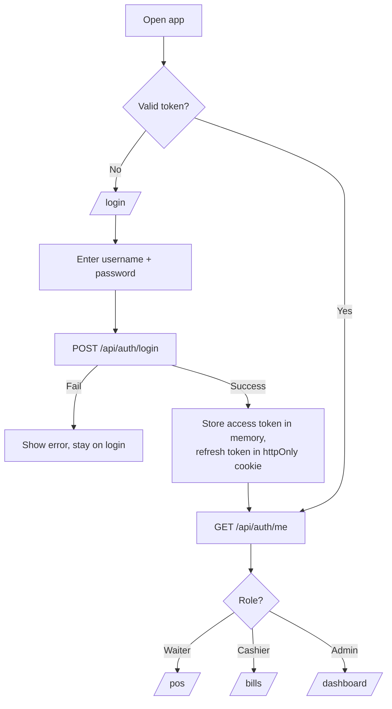
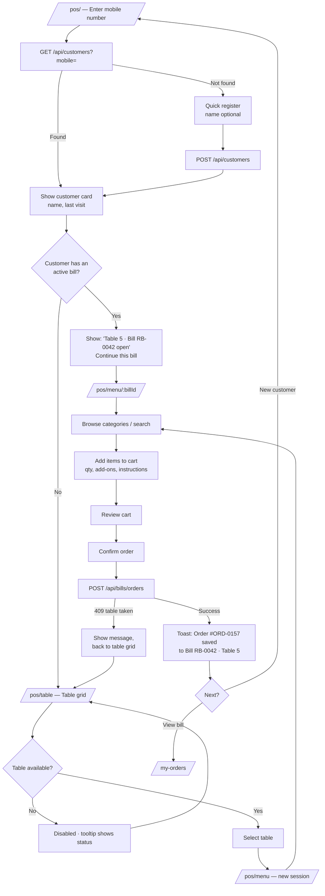
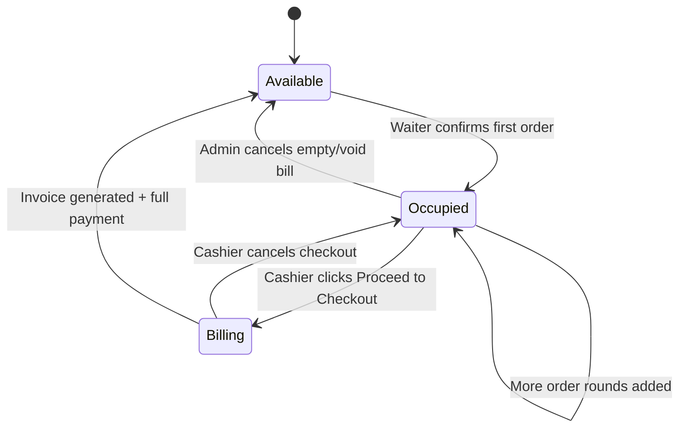
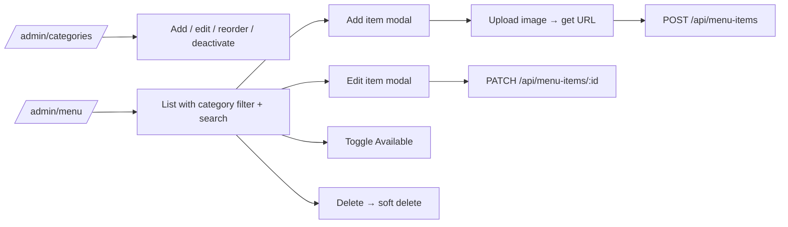
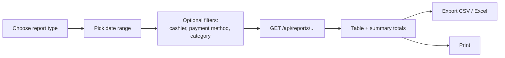

# Restaurant Billing Software — Web Flow

**Version:** 1.0
**Date:** 10 Nov 2026
**Stack:** React (frontend) · Node.js/Express (API) · MongoDB Atlas
**Companion doc:** `requirement.md`

This document describes how users move through the web app: routes, screens, navigation, and the step-by-step flow for each role, including what the frontend sends to the API and what changes in the database at each step.

---

## 1. Route Map

| Route | Screen | Admin | Waiter | Cashier |
|---|---|:-:|:-:|:-:|
| `/login` | Login | ✓ | ✓ | ✓ |
| `/` | Redirect by role | ✓ | ✓ | ✓ |
| `/dashboard` | Dashboard | ✓ | – | ✓ |
| `/pos` | POS — start order (mobile lookup) | ✓ | ✓ | – |
| `/pos/table` | POS — table selection | ✓ | ✓ | – |
| `/pos/menu/:billId?` | POS — menu & cart | ✓ | ✓ | – |
| `/my-orders` | Waiter's active bills | ✓ | ✓ | – |
| `/tables` | Table layout (live status) | ✓ | ✓ (view) | ✓ (view) |
| `/bills` | Running bills list | ✓ | – | ✓ |
| `/bills/:id` | Running bill detail | ✓ | – | ✓ |
| `/billing/:billId` | Checkout & payment | ✓ | – | ✓ |
| `/invoices` | Invoice history | ✓ | – | ✓ |
| `/invoices/:id` | Invoice view / print | ✓ | – | ✓ |
| `/customers` | Customer list & search | ✓ | ✓ | ✓ |
| `/customers/:id` | Customer profile & history | ✓ | ✓ | ✓ |
| `/admin/menu` | Menu items | ✓ | – | – |
| `/admin/categories` | Categories | ✓ | – | – |
| `/admin/tables` | Table setup | ✓ | – | – |
| `/admin/users` | Users & roles | ✓ | – | – |
| `/admin/settings` | Restaurant settings | ✓ | – | – |
| `/reports` | Sales & billing reports | ✓ | Own shift (cashier) | – |
| `*` | 404 / Not authorised | ✓ | ✓ | ✓ |

**Route guards (React):**
- `<RequireAuth>` — redirects to `/login` if there is no valid token.
- `<RequireRole roles={[...]}>` — shows "Not authorised" if the role doesn't match.
- The API enforces the same rules; frontend guards are for UX only.

---

## 2. Login & Landing Flow



- Access token expiry → silent `POST /api/auth/refresh`; if that fails, back to `/login`.
- Logout → `POST /api/auth/logout`, clear state, go to `/login`.

---

## 3. App Layout & Navigation

```
┌───────────────────────────────────────────────────────────────┐
│ Logo   Restaurant Name            [User name · Role ▾] [Logout]│
├──────────────┬────────────────────────────────────────────────┤
│ Sidebar      │                                                │
│ (role-based) │            Page content                        │
│              │                                                │
└──────────────┴────────────────────────────────────────────────┘
```

**Sidebar by role**

| Waiter | Cashier | Admin |
|---|---|---|
| New Order (POS) | Dashboard | Dashboard |
| My Orders | Running Bills | New Order (POS) |
| Tables | Tables | Running Bills |
| Customers | Invoice History | Tables |
| | Customers | Invoice History |
| | Reports (own shift) | Customers |
| | | Reports |
| | | Menu · Categories · Table Setup |
| | | Users · Settings |

On tablets the sidebar collapses to icons; the POS screen hides the sidebar entirely to give the menu full width.

---

## 4. Waiter Flow — Taking an Order

### 4.1 Overview



### 4.2 Screen: Start Order (`/pos`)

```
┌──────────────────────────────────────────┐
│  New Order                               │
│                                          │
│  Mobile number  [ 98765 43210        ]   │
│                 [ Search ]               │
│                                          │
│  ┌────────────────────────────────────┐  │
│  │ ✓ Ravi Kumar · 9876543210          │  │
│  │   12 visits · Last: 02 Nov 2026    │  │
│  │   ⚠ Active bill RB-0042 · Table 5  │  │
│  │   [ Add to this bill ]             │  │
│  └────────────────────────────────────┘  │
│                                          │
│  — or, if not found —                    │
│  New customer                            │
│  Name (optional) [               ]       │
│  [ Register & Continue ]                 │
└──────────────────────────────────────────┘
```

- Numeric keypad on tablets; auto-search when 10 digits are entered.
- Validation: exactly 10 digits, starts with 6–9.

### 4.3 Screen: Table Selection (`/pos/table`)

```
┌──────────────────────────────────────────────┐
│ Select Table          ● Available ● Occupied ● Billing │
│                                              │
│  [ T1 ]  [ T2 ]  [ T3 ]  [ T4 ]  [ T5 ]       │
│  green   red     green   amber   red          │
│                                              │
│  [ T6 ]  [ T7 ]  [ T8 ]  [ T9 ]  [ T10 ]      │
└──────────────────────────────────────────────┘
```
- Only **Available** tables are tappable.
- Grid refreshes every 10 seconds (polling) so two waiters don't race for the same table; the server is the final check.

### 4.4 Screen: Menu & Cart (`/pos/menu`)

```
┌────────────────────────────────────────────┬──────────────────────┐
│ Table 5 · Ravi Kumar · RB-0042   [Change]  │ Cart (Round 3)       │
│ [Search items........................]     │                      │
│ [All][Breakfast][Lunch][Snacks][Beverages] │ Paneer Dosa   x1  120│
│                                            │   + Extra cheese  20 │
│ ┌─────────┐ ┌─────────┐ ┌─────────┐        │   "Less spicy"       │
│ │ Masala  │ │ Paneer  │ │ Coffee  │        │ Coffee        x2   60│
│ │ Dosa    │ │ Dosa    │ │         │        │   [-] 2 [+]  [🗑]    │
│ │ ₹80 [+] │ │ ₹120[+] │ │ ₹30 [+] │        │──────────────────────│
│ └─────────┘ └─────────┘ └─────────┘        │ This round:     ₹200 │
│ ┌─────────┐                                │ Bill so far:    ₹310 │
│ │ Idli    │ (Unavailable — greyed)         │                      │
│ └─────────┘                                │ [ Previous rounds ▾ ]│
│                                            │ [  Confirm Order  ]  │
└────────────────────────────────────────────┴──────────────────────┘
```

- Tapping an item with add-ons opens a small modal: add-ons, quantity, special instructions.
- Cart lives in React state (and `sessionStorage` as a backup in case of accidental refresh).
- "Previous rounds" shows earlier rounds read-only.
- **Confirm Order** button disables on click until the API responds.

### 4.5 What Happens on Confirm

**Request** — `POST /api/bills/orders`
```json
{
  "customerId": "...",
  "tableId": "...",
  "billId": null,
  "items": [
    { "menuItemId": "...", "qty": 1, "addOnIds": ["..."], "instructions": "Less spicy" }
  ],
  "idempotencyKey": "uuid"
}
```

**Server (one transaction):**
1. If `billId` is null → create running bill (`status: open`), set table to **Occupied**, link `table.currentBillId`.
2. Look up current menu prices → snapshot name + price into the round.
3. Generate `orderNumber` from counters, push the round, recalc `subtotal`.
4. Return the updated bill.

**Errors shown to waiter:**
| Code | Message |
|---|---|
| 409 | "Table 5 was just taken. Please pick another table." |
| 422 | "Coffee is no longer available." (item removed from cart) |
| 401 | Session expired → login |

### 4.6 Screen: My Orders (`/my-orders`)

List of the waiter's open bills: Table · Customer · Rounds · Running total · Opened time. Tap → read-only bill detail with "Add more items" → `/pos/menu/:billId`.

---

## 5. Cashier Flow — Billing & Payment

### 5.1 Overview

```mermaid
flowchart TD
    A[/bills/ — Running bills list/] --> B[Search: mobile / table / bill no.]
    B --> C[Open bill detail /bills/:id]
    C --> D[Review rounds & items]
    D --> E[Proceed to Checkout]
    E --> F[POST /api/bills/:id/checkout]
    F --> G[Table → Billing<br/>Server returns calculated totals]
    G --> H[/billing/:billId/]
    H --> I[Apply discount optional]
    I --> J{Within cashier limit?}
    J -- No --> K[Error: needs admin]
    K --> I
    J -- Yes --> L[Totals recalculated:<br/>subtotal, discount, CGST, SGST, round-off]
    L --> M[Enter payment(s)]
    M --> N{Paid total = Grand total?}
    N -- No --> O[Generate button disabled<br/>shows balance due]
    O --> M
    N -- Yes --> P[Generate Invoice]
    P --> Q[POST /api/bills/:id/invoice]
    Q -- Success --> R[Invoice saved · Bill Paid<br/>Table → Available]
    R --> S[/invoices/:id — Print preview/]
    S --> T[Print]
    T --> A
    H --> U[Cancel checkout]
    U --> V[Table back to Occupied<br/>Bill back to Open]
    V --> A
```

### 5.2 Screen: Running Bills (`/bills`)

```
┌────────────────────────────────────────────────────────────────┐
│ Running Bills        [Search mobile / table / bill no.   ]     │
│ Filter: [All] [Open] [Billing]                                 │
├────────┬────────┬──────────────┬────────┬─────────┬────────────┤
│ Bill   │ Table  │ Customer     │ Rounds │ Total   │ Opened     │
├────────┼────────┼──────────────┼────────┼─────────┼────────────┤
│ RB-0042│ T5     │ Ravi · 98765…│ 3      │ ₹310    │ 07:45 PM   │
│ RB-0043│ T2     │ 91234…       │ 1      │ ₹160    │ 08:02 PM   │
└────────┴────────┴──────────────┴────────┴─────────┴────────────┘
```
Clicking a row → `/bills/:id`.

### 5.3 Screen: Bill Detail (`/bills/:id`)

- Header: bill no., table, customer, waiter(s), opened time.
- Rounds listed with timestamps; each item shows qty, rate, add-ons, amount.
- Admin only: "Void item" with reason.
- Button: **Proceed to Checkout**.

### 5.4 Screen: Checkout & Payment (`/billing/:billId`)

```
┌───────────────────────────────────┬─────────────────────────────┐
│ Bill RB-0042 · Table 5 · Ravi     │ Payment                     │
│                                   │                             │
│ Masala Dosa      2 x 80     160   │ [Cash] [UPI] [Card] [Split] │
│ Coffee           3 x 30      90   │                             │
│ Paneer Dosa      1 x 140    140   │ Cash   [  300  ]            │
│ ─────────────────────────────     │ UPI    [  112  ] Ref [....] │
│ Subtotal                    390   │                             │
│ Discount  [10%▾] [ 10 ]     -39   │ Paid:        ₹412           │
│ Taxable                     351   │ Balance:     ₹0             │
│ CGST 2.5%                  8.78   │ Change:      ₹0             │
│ SGST 2.5%                  8.78   │                             │
│ Round-off                 +0.44   │ [ Generate Invoice ]        │
│ ─────────────────────────────     │ [ Cancel Checkout ]         │
│ GRAND TOTAL                 369   │                             │
└───────────────────────────────────┴─────────────────────────────┘
```
*(Figures illustrative.)*

**Rules on this screen:**
- All totals come from the server; the frontend only displays them and re-requests calculation after a discount change.
- Cash: enter tendered amount → change shown.
- UPI/Card: transaction reference field (optional but recommended).
- Split: add multiple payment rows; balance updates live.
- **Generate Invoice** enabled only when balance = 0; disabled immediately on click.

### 5.5 What Happens on Generate Invoice

**Request** — `POST /api/bills/:id/invoice`
```json
{
  "discount": { "type": "percent", "value": 10 },
  "payments": [
    { "method": "cash", "amount": 30000 },
    { "method": "upi", "amount": 6900, "reference": "UPI123456" }
  ],
  "idempotencyKey": "uuid"
}
```
*(Amounts in paise.)*

**Server (one transaction):**
1. Verify bill is in **Billing** status and has no invoice yet.
2. Recalculate everything; reject if payments ≠ grand total.
3. Check discount ≤ cashier's limit.
4. Generate invoice number from counters.
5. Create invoice → bill `paid` → table `available`, clear `currentBillId` → update customer stats → audit log.
6. Return invoice.

Repeat request with the same idempotency key returns the same invoice instead of creating a new one.

### 5.6 Screen: Invoice View / Print (`/invoices/:id`)

- Rendered invoice with restaurant header, GSTIN, items, tax breakup, payments.
- Buttons: **Print**, **Back to Running Bills**.
- Reprint from history → `POST /api/invoices/:id/reprint` (increments print count) → prints with "DUPLICATE COPY".
- Print CSS switches layout for A4 vs 80mm based on settings.

---

## 6. Table Status Lifecycle



**Running bill status:** `open` → `billing` → `paid` (or `cancelled` by admin only).

While a table is in **Billing**, the waiter can still see it but cannot add rounds; the POS shows "Bill is being settled — ask cashier to cancel checkout to add items."

---

## 7. Admin Flows

### 7.1 Menu & Categories


Price changes take effect only on new orders.

### 7.2 Table Setup (`/admin/tables`)
- Add table: number, capacity, section.
- Edit / deactivate (blocked if the table has an active bill).

### 7.3 Users (`/admin/users`)
- Create: name, username, password, role, max discount % (cashier).
- Edit, deactivate, reset password.
- Admin cannot deactivate their own account.

### 7.4 Settings (`/admin/settings`)
Restaurant details, GSTIN, logo → GST rate, inclusive/exclusive pricing → invoice prefix and starting number → invoice footer → print format. Save → `PUT /api/settings`.

### 7.5 Bill Corrections (Admin)
- Void an item on an open bill (reason required, logged).
- Cancel an entire open bill (e.g. walk-out with no items) → table released.

---

## 8. Dashboard (`/dashboard`)

```
┌─────────────┬─────────────┬─────────────┬─────────────┐
│ Today Sales │ Bills Today │ Open Bills  │ Tables      │
│ ₹48,250     │ 96          │ 7 · ₹3,140  │ 12/20 used  │
└─────────────┴─────────────┴─────────────┴─────────────┘
┌──────────────────────────────┬────────────────────────┐
│ Payment split (today)        │ Table status grid      │
│ Cash 40% · UPI 45% · Card 15%│ (same as /tables)      │
└──────────────────────────────┴────────────────────────┘
│ Recent invoices (last 10) → click opens invoice        │
```
Data: `GET /api/dashboard/summary`, refreshed every 30 seconds.

---

## 9. Reports Flow (`/reports`)


Report types: Sales summary · Payment methods · Item-wise · Category-wise · Discounts · GST summary.

---

## 10. Customer Lookup Flow (`/customers`)

Search by mobile or name → customer profile → visit count, total spent → list of past invoices → click opens `/invoices/:id`.

---

## 11. End-to-End Example

| Time | Who | Action | Table T5 | Bill RB-0042 |
|---|---|---|---|---|
| 7:45 PM | Waiter | Enters 9876543210 → found "Ravi" → selects T5 → 2 Masala Dosa → Confirm | Occupied | Open · Round 1 · ₹160 |
| 8:05 PM | Waiter | Mobile lookup → "Add to this bill" → 3 Coffee → Confirm | Occupied | Open · Round 2 · ₹250 |
| 8:20 PM | Waiter | Adds 1 Paneer Dosa + extra cheese → Confirm | Occupied | Open · Round 3 · ₹390 |
| 8:40 PM | Cashier | Searches "T5" → reviews → Proceed to Checkout | Billing | Billing |
| 8:41 PM | Cashier | 10% discount → Cash + UPI split → Generate Invoice | Available | Paid · Invoice INV/2026-27/00096 |
| 8:41 PM | Cashier | Prints invoice → back to Running Bills | — | — |

---

## 12. Global UI Behaviour

- **Loading:** skeletons for lists, spinner on buttons; buttons disabled while requests are in flight.
- **Errors:** toast for API errors; inline messages for form validation; full-page message for 403/404.
- **Confirmations:** modal before void, cancel bill, cancel checkout, deactivate user.
- **Live status:** tables and running bills poll every 10 seconds (can be upgraded to WebSockets/Socket.IO later).
- **Currency:** ₹ with Indian number grouping (₹1,25,000); amounts held in paise internally.
- **Time:** shown in IST.
- **Keyboard:** Enter to search mobile, `/` focuses menu search, Esc closes modals.
- **Session:** idle auto-logout after a configurable period (default 8 hours for shift use).
